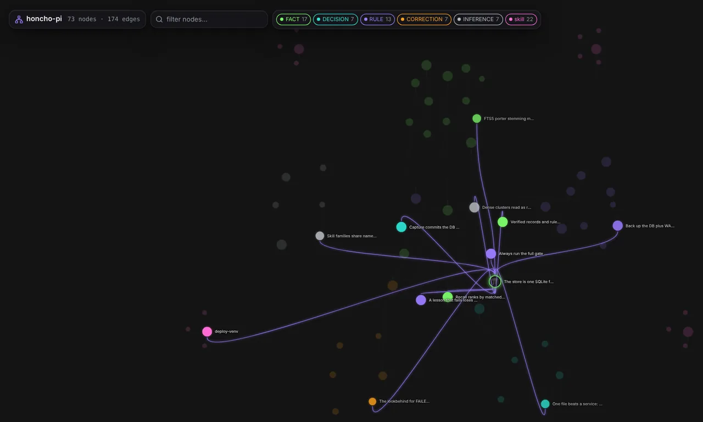
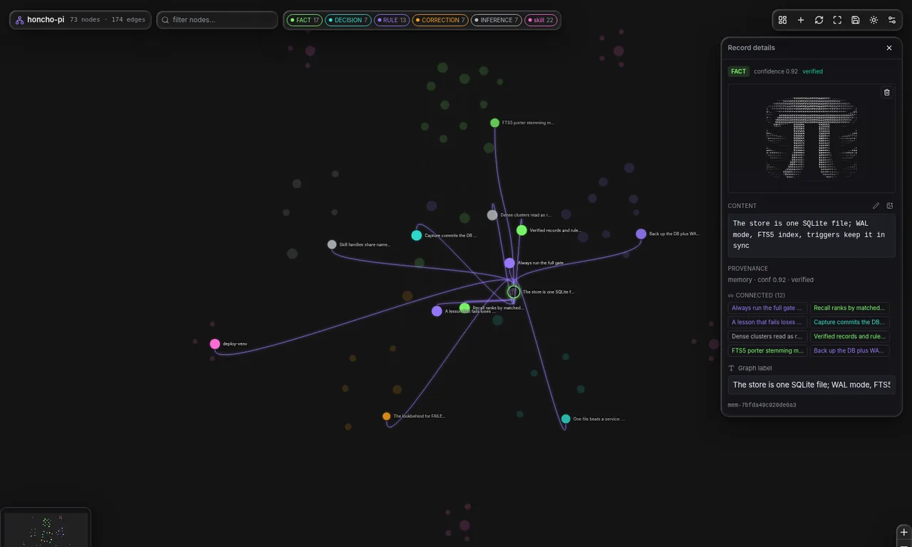
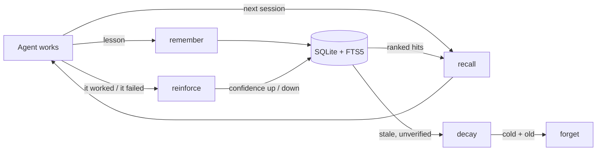

<div align="center">


# honcho-pi

### Your coding agent forgets everything. This fixes that.

One SQLite file that remembers what worked, what failed, and why.
Local-first. No server, no API key, no embeddings. Nothing leaves your machine.

[Quick start](#quick-start) | [Memory universe](#the-memory-universe)
[How it works](#how-it-works) | [MCP](#connect-your-agent)

<p>
  <a href="LICENSE.md"></a>
  
  
  
</p>

</div>

---

<div align="center">

</div>

<p align="center"><i>The memory universe: every lesson, decision, and skill your agent has learned, connected.</i></p>

## The problem

Every session, your agent starts from zero. It re-learns the same build command, repeats the same wrong
assumption, and rediscovers the same fix it found last week. You end up being the memory.

honcho-pi gives the agent a memory that behaves like memory: lessons that hold get stronger, lessons that
fail fade, and everything carries the evidence behind it.

## Quick start

```bash
npx honcho-pi@latest setup
```

That is the whole install. Python 3.10+ and Node 18+ are the only prerequisites. Then connect your agent:

```json
{
  "mcpServers": {
    "memory": { "command": "omp-memory-mcp" }
  }
}
```

Works with Claude Code, Codex, Cursor, and any MCP client. The agent gets six tools: `recall`, `remember`,
`reinforce`, `forget`, `stats`, `maintenance`. It uses them on its own; you never file anything.

## The memory universe

```bash
omp-memory overview
```

<div align="center">

</div>

Everything the agent remembers, on one canvas. Each color is a record type, each thread is a relationship.
Hover a node and its connections light up. Double-click to zoom into its neighborhood. Drag nodes to
arrange your own map; the layout is saved.

**Click any node to open it:**

<div align="center">

</div>

- **Read the full record**: content, evidence, confidence, where it came from.
- **Edit it**: fix a wrong lesson right there. The edit writes to the store as a logged correction,
  with evidence required. The agent sees the corrected version on its next recall.
- **Attach images**: screenshots, diagrams, terminal output. The node becomes a thumbnail.
  Agents can attach images too, through the same API.

**And a dashboard that answers one question: is the memory healthy?**

<div align="center">

</div>

Cold records decay toward forgetting; hot ones survive. If the cold bucket dominates, the store needs
reinforcement, not more capture. The most-connected list shows the hubs your agent actually leans on.

The screenshots above use generated demo data (`python3 web/scripts/demo-universe.py`), not anyone's
real memory.

## How it works



Three rules make it more than a notes file:

1. **Every record carries evidence.** A type (FACT, RULE, DECISION, CORRECTION, ...), a confidence score,
   a verified flag, and the proof behind it. A note written once never gets to masquerade as truth.
2. **Reality adjusts confidence.** When a lesson works, the agent reinforces it and it ranks higher.
   When it fails, it loses ground. Unused confidence decays with a 30-day half-life. Verified lessons
   and rules are exempt.
3. **The same lesson merges.** Content-addressed identity means "use uv, not pip" written by two sessions
   is one record with two sources, not duplicates fighting in search.

Recall is lexical (SQLite FTS5), reranked by confidence, recency, and past success. No embedding model,
no vector database, no network call. The whole store is one file you can `cp`, inspect with `sqlite3`,
and back up on your own schedule.

## CLI

The agent uses MCP; you can use the CLI:

```bash
omp-memory search "wal corruption"          # ranked search
omp-memory search "what broke" --explain    # why each hit ranked where it did
omp-memory search "what broke" --expand 5   # each hit plus its temporal neighbours
omp-memory search "old fact" --as-of 2025-06-01   # what was true then
omp-memory search "wal corruption" --session sess-20261126   # one capture session
omp-memory search "wal corruption" --brief      # id + first line + token estimate
omp-memory digest                           # always-in-context block for session start
omp-memory capture --task "fix WAL" --outcome "set busy_timeout" --verified
omp-memory pack team.pack                   # sync the store via a git-committable file
omp-memory unpack team.pack                 # merge on another machine (no server)
omp-memory skill-export <id> ./skills       # procedural memory -> installable SKILL.md
omp-memory stats                            # counts by type
omp-memory health                           # integrity + backup status
omp-memory overview                         # the universe, in your browser
```

Maintenance and recovery:

```bash
omp-memory maintenance decay                # age confidence toward the floor
omp-memory maintenance sleep --apply        # full consolidation pass
omp-memory maintenance forget_cold --apply  # delete cold records (report first)
omp-memory maintenance promote              # hot inferences -> FACT
omp-memory maintenance reflect --apply      # abstract patterns across sessions
omp-memory maintenance capture --apply      # extract lessons from the session log
omp-memory maintenance ingest_md --apply    # import omp's builtin memories/**/*.md
omp-memory maintenance review               # candidates + the rules to judge them by
omp-memory maintenance pending              # staged writes awaiting review
omp-memory maintenance approve --pending-id 3   # accept one staged write
omp-memory maintenance reject --pending-id 3    # refuse it
omp-memory maintenance not_conflict --a <id> --b <id>  # these two do not contradict
omp-memory backup                           # consistent snapshot (VACUUM INTO)
omp-memory repair                           # restore the newest usable snapshot
omp-memory disk                             # free space + store size
omp-memory checkpoint --session <id>        # snapshot evidence before compaction
omp-memory restore <checkpoint-id>          # rebuild from a checkpoint
```

Inspection and export:

```bash
omp-memory recap                            # summarise a session or project
omp-memory context "wal corruption"         # fenced memory block for a prompt
omp-memory scan "text"                      # secret scan, same rules as capture
omp-memory mirror ~/memory-mirror --init    # export records to a git repo
omp-memory reinforce <id> success           # record an outcome
omp-memory promote <id>                     # verified record -> RULE
omp-memory analyze                          # derive INFERENCE rows from logs
```

## What the bench shows

Measured, not claimed. Two tiers, kept separate because their metrics are not comparable:

**External, labeled** (`bench/EXTERNAL.md`, two datasets, SHA-pinned). LongMemEval
oracle, 428 scored questions: evidence retrieval R@5 **0.9556**, hit@1 **0.6285**,
every category >= 0.93 R@5. `--expand 5` lifts R@5 to **0.9836** (hit@1 unchanged,
cost unchanged) because the gold turn is often adjacent to a hit rather than the
hit itself. LoCoMo (1,977 QA, per-turn gold), measured through
`recall()` which is what the MCP server serves: hit@1 **0.2630**, R@10
**0.5878**; the same probe run through `search()` (lexical only) gives 0.3647 and
0.5190, and `--expand 5` lifts the pair to 0.3799/0.7714 at window level. LoCoMo
is near the lexical ceiling: on the sampled failing question the gold turn and
all three turns that beat it share exactly 4 of 9 query tokens. This measures
**evidence retrieval**, not QA accuracy or F1; no vendor comparison is implied.

**Internal, self-referential** (`bench/RESULTS.md`, pinned synthetic corpus):
update-correctness 4/4, freshness ~8ms, R@5=1.0 saturated -- useful for
regression and latency, NOT a quality claim. Five ranking arms raced on
partial-evidence probes; incumbent wins, PPR earns +0.01 hit@1 over no-PPR.
No weight changes without a run that beats the incumbent.

Published numbers (Zep freshness 162.7s / 8-of-24 updates; mem0 v3 ADD-only)
come from vendor reports and are **not** directly comparable to our metrics.
Mem0's current code does implement update and delete with history events;
the "never invalidates" phrasing described an older published snapshot.

## Surviving a model switch

The MCP `handoff` tool is pull-only: a fresh model has to *know* to call it,
and after a real switch it does not. omp emits no `model_change` event to
extensions, so the working mechanism is the `context`/`before_agent_start`
extension API, not a hook on the switch itself.

Two things make it automatic:

1. **A brief built from evidence** (`handoff.py`): the operator's verbatim
   requests, decisions and corrections from memory, observed failures, files
   touched. No model paraphrase. Role-filtered so retry-fallback hops
   (`role != "default"`) are not counted as switches — omp's own
   `lastModelChangeRole(skipEphemeral)` skips the same rows.
2. **An extension that delivers it** (`~/.omp/agent/extensions/omp-handoff.ts`)
   on `before_agent_start`, by comparing `ctx.model` with the last model it
   wrote to a state file. Verified API shape: `BeforeAgentStartEventResult`
   has exactly `message` and `systemPrompt`; `additionalContext` is **not** a
   field and is silently ignored.

Guards learned from the real transcript: a 120 s debounce (one observed
flip-flop was 0.3 minutes apart), one brief per switch key, and a 400-char
minimum so an almost-empty session does not inject noise. The injected text
is wrapped in `BEGIN/END HANDOFF EVIDENCE` markers and labelled data, because
a model given an unmarked block will happily invent its contents.

## Connect your agent

**MCP client** (Claude Code, Codex, Cursor, ...): the JSON block from [Quick start](#quick-start).

**Any agent with a shell**: paste this into its instructions:

```text
Set up the honcho-pi memory: run `npx honcho-pi@latest setup`, then follow its README.
```

**Python**:

```python
import omp_memory as m

conn = m.connect()
m.remember(conn, "FACT", "Install dependencies with uv, not pip", verified=1, source="s1")
hits = m.recall(conn, "install dependencies", limit=3)
```

## Reliability

| Concern | Behavior |
| --- | --- |
| Concurrent writers | WAL mode, 30 s lock wait |
| Backup | `VACUUM INTO` snapshot, rotated |
| Corrupt database | raises and keeps the file; `repair` restores from the newest usable backup |
| Secret leakage | capture, MCP writes, and the web editor scan for secrets before storing |
| Disk exhaustion | CLI capture refuses below 100 MB free |
| Unreviewed writes | `capture --staging` parks candidates in `pending_writes` with a content hash; `approve` is the only path that writes them, and a payload changed after staging raises instead of approving |
| Stale evidence | an anchor file whose checksum changed marks the record `stale`, and `recall` scores it 0.20 lower |
| Pruning safety | `sleep` only merges records that clear the same three guards a write does: score >= 0.85, identical numbers, no rare-token veto |

`omp-memory health` also reports what is decaying, not just whether the file is
sound: `never_retrieved` (share of records recall has never returned),
`duplicate_groups`, `stale_anchors`, `superseded`, `low_confidence`.

## Why a hit ranked where it did

`recall(explain=True)` (or `search --explain`) attaches the score
decomposition per hit:

```json
{"terms": {"lexical": 0.682583, "heat": 0.124067, "type_prior": 0.05, "ppr": 0.1},
 "total": 0.95665,
 "heat_parts": {"confidence": 0.55, "recency": 0.995076, "reinforcement": 0.0}}
```

The terms are the weighted values the ranker summed, so they add up to the
score exactly. There is no approximation to disagree with the ranking.

## Feature inventory

Measured from the running code, not from this file.

**MCP tools (8):** `recall` (query, limit, type, project, session,
verified_only, min_confidence, brief, as_of, expand, explain), `remember`,
`reinforce`, `forget`, `stats`, `maintenance` (11 ops), `digest`, `handoff`.

**CLI (22 commands):** capture, search, recap, context, reinforce, promote,
analyze, health, stats, digest, maintenance, backup, repair, mirror,
skill-export, pack, unpack, disk, scan, overview, checkpoint, restore.

**Engine:** FTS5 bm25 with per-type divisor and column weights; synonym
concept groups; vocabulary gate; typo repair; PPR association graph with hub
penalty and weakest-link bonus; MMR; bi-temporal `as_of`; `not_conflict`
adjudication; power-law decay (30-day half-life); reinforcement signals;
consolidation; spacing effect; retrieval-induced forgetting; reconsolidation
gate; staging with hash pinning; checksum anchors; provenance penalty; budgeted
digest; markdown / SKILL.md / sync-pack export; web graph UI; session capture;
builtin-markdown ingestion; handoff brief + omp extension.

## Configuration

| Variable | Default | Meaning |
| --- | --- | --- |
| `OMP_MEMORY_DB` | `~/.omp/memory/memory.db` | database file |
| `OMP_MEMORY_BACKUP_DIR` | `~/.omp/memory/backups` | snapshot directory |
| `OMP_MEMORY_MAX_BACKUPS` | `10` | snapshots kept (newest win) |
| `OMP_MEMORY_BUSY_TIMEOUT_MS` | `30000` | SQLite lock wait |
| `OMP_MEMORY_WEB_DIR` | bundled assets | UI root for `overview` |
| `OMP_MEMORY_IDLE_SECONDS` | `600` | watch: idle before a sleep pass |
| `OMP_MEMORY_POLL_SECONDS` | `60` | watch: poll interval |
| `OMP_MEMORY_SLEEP_INTERVAL` | `3600` | watch: seconds between sleep passes |
| `OMP_MEMORY_SESSIONS` | agent sessions dir | where `capture` reads logs from |
| `OMP_PROFILE` | `default` | profile name under `~/.omp/profiles` |
| `HONCHO_HOME` | `~/.omp/profiles/<p>/agent/honcho` | MCP data root |
| `HONCHO_MAX_RECALL` | `8` | default recall limit |
| `HONCHO_TRANSPORT` | `stdio` | `stdio` or `http` |
| `HONCHO_PORT` | `8765` | HTTP port when `HONCHO_TRANSPORT=http` |
| `HONCHO_TOKENS` | unset | comma list of bearer tokens for HTTP mode |
| `HONCHO_EXTRA_TOOLS` | unset | `os.pathsep` list of extra tool directories |

Every value is parsed tolerantly: a malformed number falls back to its default
instead of stopping the server from starting.

Updates: `npx honcho-pi@latest update` (keeps the database). Status: `npx honcho-pi@latest status`.

## Development

```bash
python -m pytest              # 526 tests, no network
bash bin/clean-code.sh        # quality gate
bash bin/web-deploy.sh        # build + deploy the web UI
```

## License

MIT. See [LICENSE.md](LICENSE.md).