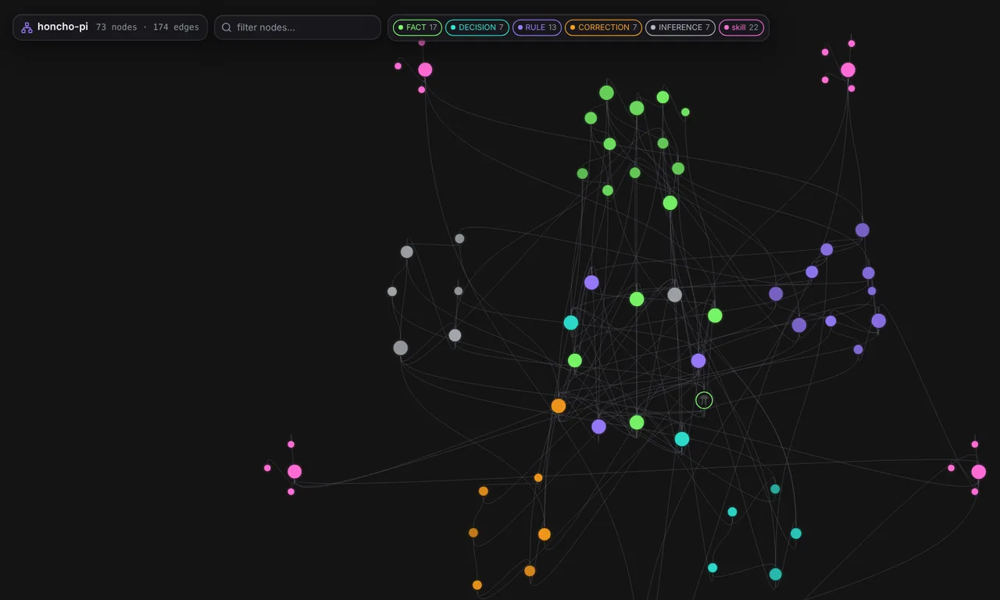
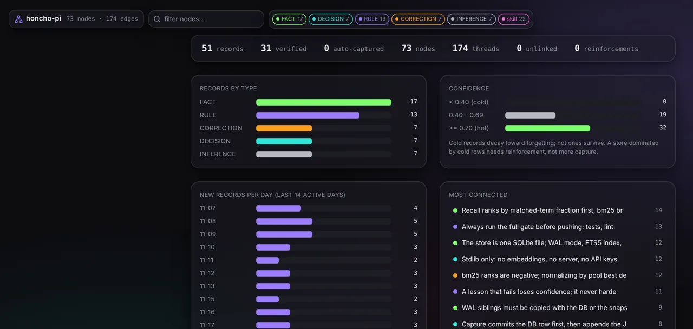
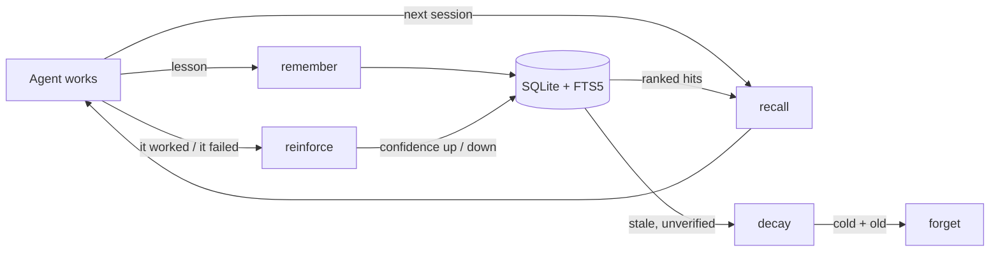

<div align="center">


# honcho-pi

### Your coding agent forgets everything. This fixes that.
honcho-pi gives the agent a memory that behaves like memory: lessons that hold get stronger, lessons that
fail fade, and everything carries the evidence behind it.

One SQLite file that remembers what worked, what failed, and why.
Local-first. No server, no API key, no embeddings. Nothing leaves your machine.
[Quick start](#quick-start) | [Memory universe](#the-memory-universe)
[How it works](#how-it-works) | [MCP](#connect-your-agent)
</div>
---
<div align="center">

</div>
## The problem
Every session, your agent starts from zero. It re-learns the same build command, repeats the same wrong
assumption, and rediscovers the same fix it found last week. You end up being the memory.
honcho-pi gives the agent a memory that behaves like memory: lessons that hold get stronger, lessons that
fail fade, and everything carries the evidence behind it.
## Quick start

```bash
npx honcho-pi@latest setup
```

That is the whole install. Python 3.10+ and Node 18+ are the only prerequisites. Then connect your agent:

```json
{
  "mcpServers": {
    "memory": { "command": "omp-memory-mcp" }
  }
}
```

Works with Claude Code, Codex, Cursor, and any MCP client. The agent gets five tools: `recall`, `remember`,
`reinforce`, `forget`, `stats`. It uses them on its own; you never file anything.

## The memory universe

```bash
omp-memory overview
```
<div align="center">

</div>
Everything the agent remembers, on one canvas. Each color is a record type, each thread is a relationship.
Hover a node and its connections light up. Double-click to zoom into its neighborhood. Drag nodes to
arrange your own map; the layout is saved.
**Click any node to open it:**
<div align="center">

</div>
- **Read the full record**: content, evidence, confidence, where it came from.
- **Edit it**: fix a wrong lesson right there. The edit writes to the store as a logged correction,
  with evidence required. The agent sees the corrected version on its next recall.
- **Attach images**: screenshots, diagrams, terminal output. The node becomes a thumbnail.
  Agents can attach images too, through the same API.
**And a dashboard that answers one question: is the memory healthy?**
<div align="center">

</div>
Cold records decay toward forgetting; hot ones survive. If the cold bucket dominates, the store needs
reinforcement, not more capture. The most-connected list shows the hubs your agent actually leans on.

The screenshots above use generated demo data (`python3 web/scripts/demo-universe.py`), not anyone's
real memory.
<div align="center">

</div>

## How it works



Three rules make it more than a notes file:

1. **Every record carries evidence.** A type (FACT, RULE, DECISION, CORRECTION, ...), a confidence score,
   a verified flag, and the proof behind it. A note written once never gets to masquerade as truth.
2. **Reality adjusts confidence.** When a lesson works, the agent reinforces it and it ranks higher.
   When it fails, it loses ground. Unused confidence decays with a 30-day half-life. Verified lessons
   and rules are exempt.
3. **The same lesson merges.** Content-addressed identity means "use uv, not pip" written by two sessions
   is one record with two sources, not duplicates fighting in search.

Recall is lexical (SQLite FTS5), reranked by confidence, recency, and past success. No embedding model,
no vector database, no network call. The whole store is one file you can `cp`, inspect with `sqlite3`,
and back up on your own schedule.

## CLI

The agent uses MCP; you can use the CLI:

```bash
omp-memory search "wal corruption"          # ranked search
omp-memory capture --task "fix WAL" --outcome "set busy_timeout" --verified
omp-memory stats                            # counts by type
omp-memory health                           # integrity + backup status
omp-memory backup                           # consistent snapshot (VACUUM INTO)
omp-memory overview                         # the universe, in your browser
```

## Connect your agent

**MCP client** (Claude Code, Codex, Cursor, ...): the JSON block from [Quick start](#quick-start).

**Any agent with a shell**: paste this into its instructions:

```text
Set up the honcho-pi memory: run `npx honcho-pi@latest setup`, then follow its README.
```

**Python**:

```python
import omp_memory as m

conn = m.connect()
m.remember(conn, "FACT", "Install dependencies with uv, not pip", verified=1, source="s1")
hits = m.recall(conn, "install dependencies", limit=3)
```

## Reliability

| Concern | Behavior |
| --- | --- |
| Concurrent writers | WAL mode, 30 s lock wait |
| Backup | `VACUUM INTO` snapshot, rotated |
| Corrupt database | quarantine and restore from backup; never delete |
| Secret leakage | capture scans for secrets before storing |
| Disk exhaustion | capture refuses below 100 MB free |

## Configuration

| Variable | Default |
| --- | --- |
| `OMP_MEMORY_DB` | `~/.omp/memory/memory.db` |
| `OMP_MEMORY_BACKUP_DIR` | `~/.omp/memory/backups` |
| `OMP_MEMORY_MAX_BACKUPS` | `10` |
| `OMP_MEMORY_WEB_DIR` | built UI assets for `overview` |

Updates: `npx honcho-pi@latest update` (keeps the database). Status: `npx honcho-pi@latest status`.

## Development

```bash
python -m pytest              # 384 tests, no network
bash bin/clean-code.sh        # quality gate
bash bin/web-deploy.sh        # build + deploy the web UI
```

## License

MIT. See [LICENSE.md](LICENSE.md).